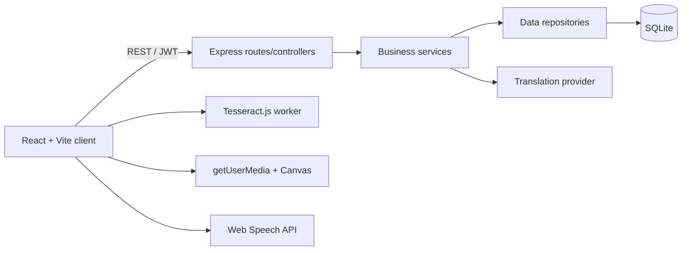

# LinguaLens AR

Real-time multilingual translation for smart tourism. LinguaLens uses a browser camera, Tesseract.js OCR, a Canvas/WebRTC capture loop, Three.js AR accents, MyMemory translation, and Web Speech text-to-speech.

## Folder tree

```text
lingualens-ar/
├── client/
│   └── src/
│       ├── App.tsx
│       ├── main.tsx
│       └── styles.css
├── server/
│   └── src/
│       ├── data/          # SQLite schema and repositories
│       ├── services/      # Business logic only
│       ├── middleware/
│       ├── controllers.ts
│       ├── routes.ts
│       └── index.ts
├── .env.example
└── package.json
```

## Setup

1. Install Node.js 20+.
2. Copy `.env.example` to `.env` and set a long `JWT_SECRET`.
3. Run `npm install`, `npm install --prefix client`, and `npm install --prefix server`.
4. Run `npm run dev`.
5. Open `http://localhost:5173`. Allow camera access for live mode. The app retains a demo scene when a camera is unavailable.

SQLite is created automatically at `server/data/lingualens.sqlite`. The API runs on port 4000.

## Architecture



Presentation code in `/client` never accesses SQLite. Controllers call `/server/services`, and services call `/server/data` repositories.

## Demo script

1. Select **Try LinguaLens** and create an account.
2. Allow camera access; select a target language from the top bar.
3. Press **Start scan**. OCR reads the current camera frame and the translated AR label appears over the detected region.
4. Use the speaker, copy, and history controls. Adjust text size and overlay color from Settings.
5. Refresh the page: the JWT keeps the account session available.

## Screenshots

Run the app locally and capture the landing, authentication, and translator views. A camera permission is required for the live translator view; the UI includes a graceful demo mode for browsers without a camera.
